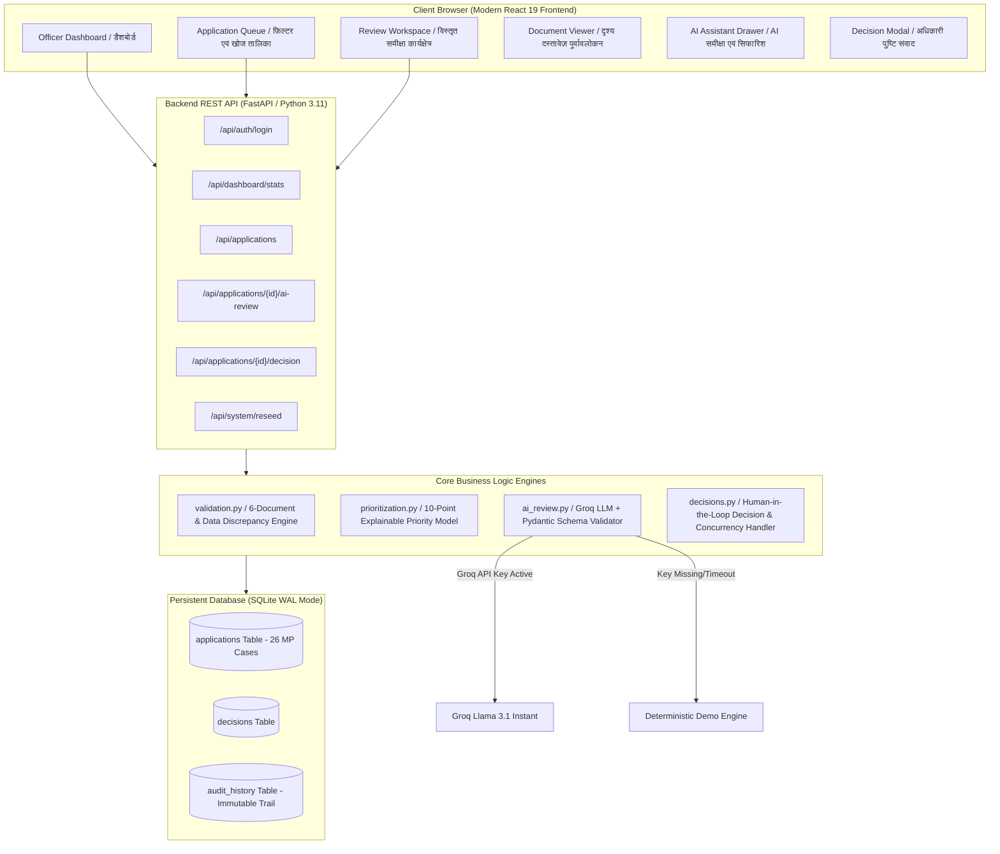

# JanSahayak AI — जनसहायक AI (v2.0 Full Stack MVP)
### Production-Grade AI-Assisted Government Application Review System (आय प्रमाण पत्र समीक्षा सहायक)
**Full Stack AI Engineer Hiring Assignment for Kenpath**

> **⚠️ महत्वपूर्ण अस्वीकरण (Demo Disclaimer):**  
> यह प्रणाली केवल एक **प्रदर्शन प्रोटोटाइप / हायरिंग असाइनमेंट MVP (Demonstration Prototype / Hiring MVP)** है, किसी भी सरकारी विभाग की आधिकारिक सेवा नहीं है। इसमें प्रयुक्त सभी 26 नागरिक आवेदन, नाम, पते एवं अभिलेख पूर्णतः **काल्पनिक (Synthetic/Fictional)** हैं। किसी भी वास्तविक जीवित व्यक्ति अथवा सरकारी नागरिक डेटा से इसका कोई संबंध नहीं है।

---

## 1. Project Overview & Architecture (परियोजना परिचय एवं वास्तुकला)

**JanSahayak AI — जनसहायक AI** मध्य प्रदेश शासन के राजस्व एवं लोक सेवा प्रबंधन अधिकारियों (तहसीलदार / नायब तहसीलदार / राजस्व निरीक्षक) के लिए तैयार किया गया एक आधुनिक, उच्च-प्रदर्शनयुक्त वेब कार्यक्षेत्र (Full Stack Administrative Workspace) है। 

प्रणाली दोहरी वास्तुकला (Modern Full-Stack Decoupled Architecture) पर आधारित है:
- **Frontend:** **React 19** (Vite + Vanilla CSS Design System + Lucide Icons + Google Fonts Noto Sans Devanagari) — तीव्र, उत्तरदायी, आधुनिक सरकारी पोर्टल डिज़ाइन जिसमें इंटरएक्टिव दस्तावेज़ पूर्वावलोकन (Simulated Document Viewer), डायनामिक फ़िल्टर और AI समीक्षा सहायक शामिल हैं।
- **Backend:** **FastAPI + Pydantic v2 + SQLite (WAL Mode)** — उच्च गति वाला REST API सर्वर, जिसमें नियम-आधारित गणितीय सत्यापन (Deterministic Rules Engine), व्याख्या योग्य प्राथमिकता स्कोरिंग (Explainable Prioritization), Groq AI LLM (`llama-3.1-8b-instant`) एकीकरण एवं अपरिवर्तनीय ऑडिट ट्रेल सम्मिलित है।
- **Unified Single-Command Deployment:** प्रोडक्शन बिल्ड में FastAPI सीधे कंपाइल किए गए React बंडल (`frontend/dist`) को स्टैटिक रूप से सर्व करता है, जिससे संपूर्ण ऐप को `python run.py` द्वारा एक ही पोर्ट पर चलाया जा सकता है।

---

## 2. Problem Statement & Local Relevance (उत्पाद समस्या एवं स्थानीय संदर्भ)

मध्य प्रदेश के लोक सेवा केंद्रों और आरसीएमएस (RCMS) पोर्टल के माध्यम से प्रतिदिन हजारों आय प्रमाण पत्र (Income Certificate) आवेदन प्राप्त होते हैं।
1. **समय-सीमा एवं बैकलॉग:** मध्य प्रदेश लोक सेवा प्रदाय गारंटी अधिनियम 2010 के तहत 15 कार्य दिवसों में निस्तारण अनिवार्य है। अधिकारियों के पास लंबित प्रकरणों में यह पता लगाने का कोई तीव्र साधन नहीं होता कि कौन से आवेदन समयसीमा पार (overdue) हो रहे हैं।
2. **दस्तावेज़ों का मैनुअल मिलान:** 6 मानक अभिलेखों (पहचान, पता, आय, राशन कार्ड, शपथ पत्र, बैंक विवरण) की जांच में अत्यधिक समय व्यर्थ होता है।
3. **आय विसंगतियां (Data Discrepancies):** घोषित आय और वेतन पर्ची / खसरा रिकॉर्ड में अंतर को खोजना कठिन होता है।
4. **पारदर्शिता एवं जवाबदेही (Accountability):** निर्णयों का अपरिवर्तनीय साक्ष्य-आधारित ऑडिट ट्रेल सुरक्षित रखना आवश्यक है।

---

## 3. Architecture & Data Flow (Mermaid आरेख)



---

## 4. Key Features (मुख्य विशेषताएं)

| सुविधा | तकनीकी विवरण |
|---|---|
| **📊 कार्यकारी डैशबोर्ड** | कुल आवेदन, लंबित प्रकरण, उच्च प्राथमिकता, अधूरे दस्तावेज़ एवं 14+ दिन पुराने बैकलॉग की रीयल-टाइम गणना। |
| **📋 त्वरित खोज एवं बहु-फ़िल्टर** | आवेदन क्रमांक, नाम (हिंदी/अंग्रेजी), जिला, तहसील, स्थिति (स्वीकृत/अस्वीकृत/वापस), प्राथमिकता एवं दस्तावेज़ पूर्णता से तत्काल फ़िल्टर। |
| **👁️ दृश्य दस्तावेज़ पूर्वावलोकन (Simulated Document Viewer)** | आधार कार्ड (तिरंगा स्ट्राइप युक्त), राशन कार्ड (उचित मूल्य दुकान सील), वेतन पर्ची, खसरा बी-1 खतौनी एवं शपथ पत्र का यथार्थवादी विज़ुअल पूर्वावलोकन। |
| **🎯 पारदर्शी प्राथमिकता स्कोरिंग** | लंबित दिन (Days), लापता दस्तावेज़, विसंगतियों एवं तत्कालता पर आधारित 10-पॉइंट स्कोरिंग और स्पष्ट हिंदी व्याख्या। |
| **🤖 AI समीक्षा सहायक (Groq LLM)** | Groq API (`llama-3.1-8b-instant`) द्वारा हिंदी सारांश, कमियों की पहचान, सिफारिश एवं विश्वास स्तर। API key न होने पर सुरक्षित **डेमो समीक्षा फॉलबैक**। |
| **⚖️ त्रि-मार्गी निर्णय (Human-in-the-Loop)** | **स्वीकृत करें (Approve)**, **अस्वीकृत करें (Reject)**, **सुधार हेतु वापस करें (Return)** — अनिवार्य आदेश टिप्पणी, त्वरित सुझाव चिप्स एवं पुष्टि संवाद के साथ। |
| **📜 संपूर्ण ऑडिट लॉग** | प्रत्येक निर्णय, अधिकारी का नाम, पद, समय, टिप्पणी, स्थिति परिवर्तन और AI सिफारिश का अपरिवर्तनीय इतिहास। |
| **🔄 एक-क्लिक डेटा रीसेट** | मध्य प्रदेश के 26 जिलों के समृद्ध काल्पनिक डेटासेट को कभी भी पुनः स्थापित करने की सुविधा। |

---

## 5. Augmented Mock Dataset (26 विविध मध्य प्रदेश नागरिक प्रकरण)

डेटासेट में मध्य प्रदेश के 26 प्रमुख जिलों (भोपाल, इंदौर, जबलपुर, ग्वालियर, उज्जैन, सागर, रीवा, छिंदवाड़ा, देवास, सतना, विदिशा, नर्मदापुरम, मंदसौर, सीहोर, खरगोन, रतलाम, बैतूल, धार, सिंगरौली, दमोह, रायसेन, शिवपुरी, मुरैना, नीमच, बालाघाट, राजगढ़) के विविध 26 मामले शामिल हैं:
1. **पूर्ण आवेदन:** समस्त 6 दस्तावेज़ संलग्न एवं नियमानुसार (MP-INC-2024-0001)
2. **आय प्रमाण लापता:** दैनिक मजदूर, आय पर्ची अनुपलब्ध (MP-INC-2024-0002)
3. **पहचान प्रमाण लापता:** किराना व्यापारी, आधार कार्ड अनुपलब्ध (MP-INC-2024-0003)
4. **घोषित आय बनाम वेतन विसंगति:** घोषित ₹2.4 लाख परंतु वेतन पर्ची में ₹3.6 लाख (MP-INC-2024-0004)
5. **अनुबंधित कर्मचारी:** समस्त दस्तावेज पूर्ण (MP-INC-2024-0005)
6. **26 दिन पुराना बैकलॉग:** समयसीमा पार, 3 दस्तावेज गायब (MP-INC-2024-0006)
7. **सुधार हेतु वापस:** राशन कार्ड व बैंक विवरण अपेक्षित (MP-INC-2024-0007)
8. **पूर्व-स्वीकृत प्रमाण पत्र:** पटवारी व तहसीलदार द्वारा जारी (MP-INC-2024-0008)
9. **पूर्व-अस्वीकृत आवेदन:** ITR में आय अधिक होने के कारण खारिज (MP-INC-2024-0009)
10. **अतिथि शिक्षिका:** सेवा प्रमाण पत्र संलग्न (MP-INC-2024-0010)
11. **ऑटो चालक:** चालक संघ प्रमाण पत्र अपेक्षित (MP-INC-2024-0011)
12. **पुरानी बैंक पासबुक:** 2 वर्ष पुरानी पासबुक (तारीख विसंगति) (MP-INC-2024-0012)
13. **अपर्याप्त विवरण:** आय व परिवार सदस्य संख्या शून्य (MP-INC-2024-0013)
14. **उच्च तत्कालता:** पुत्री की उच्च शिक्षा छात्रवृत्ति हेतु (MP-INC-2024-0014)
15. **मनरेगा जॉब कार्ड धारक:** वनोपज व दैनिक मजदूरी (MP-INC-2024-0015)
16. **मिठाई दुकान कारीगर:** नियोक्ता पत्र संलग्न (MP-INC-2024-0016)
17. **विधवा पेंशनर:** 22 दिनों से लंबित, तत्काल निराकरण अपेक्षित (MP-INC-2024-0017)
18. **पीथमपुर औद्योगिक श्रमिक:** वेतन विसंगति (MP-INC-2024-0018)
19. **घरेलू सहायिका:** अनुसूचित जनजाति कोल समाज (MP-INC-2024-0019)
20. **सीएम हेल्पलाइन प्रकरण:** 28 दिनों से लंबित बैकलॉग (MP-INC-2024-0020)
21. **EWS छात्रवृत्ति:** मंडीदीप औद्योगिक श्रमिक (MP-INC-2024-0021)
22. **सुधार उपरांत पुनः प्रेषित:** पिछोर शिवपुरी (MP-INC-2024-0022)
23. **कृषि एवं दुग्ध व्यवसाय:** अंबाह मुरैना (MP-INC-2024-0023)
24. **अफीम पट्टा व लहसुन व्यापारी:** मंडी टैक्स विसंगति (MP-INC-2024-0024)
25. **माटी कला बोर्ड पंजीकृत कुम्हार:** हस्तशिल्प कारीगर (MP-INC-2024-0025)
26. **30+ दिन पुराना गंभीर बैकलॉग:** ब्यावरा राजगढ़ (MP-INC-2024-0026)

---

## 6. Local Setup Instructions (स्थापना एवं निष्पादन निर्देश)

### आवश्यकताएं
- **Python:** 3.10+
- **Node.js:** v18+ (v24 समर्थित)
- **Git**

### एक-कमांड में संपूर्ण एप्लिकेशन चलाएं (Unified Mode):

```powershell
# 1. रिपॉजिटरी क्लोन करें
cd "d:\JanSahayak AI"

# 2. पाइथन निर्भरताएं स्थापित करें
pip install -r requirements.txt

# 3. यदि आवश्यक हो तो फ्रंटएंड प्रोडक्शन बंडल बनाएं (पहले से संकलित है)
cd frontend
npm install
npm run build
cd ..

# 4. सर्वर प्रारंभ करें (FastAPI + React दोनों http://localhost:8000 पर)
python run.py
```

ब्राउज़र स्वतः **`http://localhost:8000`** पर खुल जाएगा।

### डेवलपर मोड (Vite HMR + FastAPI):
यदि आप फ्रंटएंड कोड में लाइव बदलाव देखना चाहते हैं:
- टर्मिनल 1: `uvicorn api:app --port 8000 --reload`
- टर्मिनल 2: `cd frontend && npm run dev` (खुलेगा `http://localhost:5173`)

### डेमो लॉगिन क्रेडेंशियल्स:
- **Username:** `officer`
- **Password:** `jansahayak2024`
*(लॉगिन स्क्रीन पर "⚡ एक क्लिक में क्रेडेंशियल्स भरें" बटन भी उपलब्ध है)*

---

## 7. Environment Variables (.env)

`.env` फ़ाइल की संरचना:

```ini
# --- Demo Authentication ---
DEMO_USERNAME=officer
DEMO_PASSWORD=jansahayak2024
DEMO_OFFICER_NAME=श्री राजेश शर्मा
DEMO_OFFICER_ID=OFF-MP-001

# --- Groq AI API (वैकल्पिक - यदि न हो तो सुरक्षित डेमो फॉलबैक स्वतः चलेगा) ---
GROQ_API_KEY=gsk_your_groq_api_key_here
GROQ_MODEL=llama-3.1-8b-instant
GROQ_TIMEOUT=30

# --- Database ---
DATABASE_PATH=jansahayak.db
SEED_DATA_PATH=data/sample_applications.json
```

---

## 8. Automated Tests (परीक्षण रिपोर्ट)

प्रोजेक्ट में **58 स्वचालित परीक्षण** सम्मिलित हैं (14 API एंडपॉइंट टेस्ट + 17 निर्णय टेस्ट + 12 प्राथमिकता स्कोरिंग टेस्ट + 15 सत्यापन टेस्ट):

```bash
pytest
```

### आउटपुट:
```text
============================= test session starts =============================
platform win32 -- Python 3.11.3, pytest-9.1.1
collected 58 items

tests\test_api.py ..............                                         [ 24%]
tests\test_decisions.py .................                                [ 53%]
tests\test_prioritization.py ............                                [ 74%]
tests\test_validation.py ...............                                 [100%]

======================== 58 passed, 1 warning in 3.76s ========================
```

---

## 9. Live Cloud Deployment Guide (लाइव डिप्लॉयमेंट निर्देश)

प्रोजेक्ट को क्लाउड पर दो प्रकार से आसानी से डिप्लॉय किया जा सकता है:

### विकल्प A: Render / Railway / DigitalOcean (Unified Single Container)
1. GitHub पर कोड पुश करें।
2. Render पर **"New Web Service"** बनाएं।
3. Build Command: `pip install -r requirements.txt && cd frontend && npm install && npm run build && cd ..`
4. Start Command: `uvicorn api:app --host 0.0.0.0 --port $PORT`
5. Environment Variables में `GROQ_API_KEY` दर्ज करें।

### विकल्प B: Vercel (Frontend) + Render (Backend)
- Frontend को सीधे Vercel पर डिप्लॉय करें (`cd frontend && vercel`).
- Backend को Render / Railway पर डिप्लॉय करें और `vite.config.js` में बैकएंड का URL दें।

---

## 10. File Structure (परियोजना फ़ाइल संरचना)

```text
JanSahayak AI/
├── api.py                      # FastAPI REST API सर्वर एवं स्टेटिक फ़ाइल माउंटिंग
├── run.py                      # एकीकृत वन-कमांड रनर (http://localhost:8000)
├── config.py                   # केंद्रीय विन्यास एवं वज़न
├── generate_data.py            # 26 काल्पनिक म.प्र. नागरिक डेटा जनरेटर
├── requirements.txt            # पाइथन निर्भरताएं (FastAPI, Uvicorn, Groq, Pydantic)
├── README.md                   # विस्तृत द्विभाषी तकनीकी दस्तावेज़ीकरण
├── .env.example                # पर्यावरण चर टेम्पलेट
├── data/
│   └── sample_applications.json# 26 यथार्थवादी म.प्र. आवेदन (JSON)
├── services/
│   ├── database.py             # SQLite स्कीमा, सीडिंग, ACID लेनदेन
│   ├── validation.py           # नियम-आधारित 6-दस्तावेज़ एवं फ़ील्ड सत्यापन
│   ├── prioritization.py       # पारदर्शी 10-पॉइंट प्राथमिकता स्कोरिंग
│   ├── ai_review.py            # Groq Llama 3.1 + Pydantic + डेमो फॉलबैक
│   ├── decisions.py            # स्वीकृत/अस्वीकृत/वापसी एवं ऑडिट ट्रेल
│   └── authentication.py       # डेमो प्रमाणीकरण
├── frontend/                   # आधुनिक React 19 + Vite सिंगल-पेज एप्लिकेशन
│   ├── index.html              # Devanagari गूगल फ़ॉन्ट्स एवं मेटाडेटा
│   ├── vite.config.js          # प्रॉक्सी एवं बिल्ड विन्यास
│   ├── package.json            # React, Lucide-React निर्भरताएं
│   ├── dist/                   # संकलित प्रोडक्शन बंडल
│   └── src/
│       ├── main.jsx            # React रूट माउंट
│       ├── App.jsx             # मुख्य स्टेट, टैब राउटिंग, टोस्ट सूचनाएं
│       ├── index.css           # संपूर्ण डिज़ाइन सिस्टम, शासकीय थीम एवं बैज
│       └── components/
│           ├── Navbar.jsx      # शीर्ष नेवबार, म.प्र. एम्बलेम, घड़ी, लॉगआउट
│           ├── Dashboard.jsx   # 5 मुख्य KPI कार्ड्स, SLA ट्रैकर, चेतावनी
│           ├── ApplicationList.jsx # लाइव खोज, 5 फ़िल्टर, क्रमबद्धता तालिका
│           ├── ApplicationDetail.jsx # विस्तृत समीक्षा कार्यक्षेत्र, AI व निर्णय पैनल
│           ├── DocumentModal.jsx # आधार, राशन कार्ड, वेतन पर्ची दृश्य पूर्वावलोकन
│           ├── AuditHistoryPage.jsx # अपरिवर्तनीय डिजिटल ऑडिट इतिहास
│           ├── HelpPage.jsx    # म.प्र. आय प्रमाण पत्र SOP एवं AI नीति
│           └── LoginModal.jsx  # आधिकारिक लॉगिन संवाद एवं ऑटो-फिल
└── tests/
    ├── test_api.py             # FastAPI REST एंडपॉइंट ऑटोमेटेड टेस्ट
    ├── test_validation.py      # नियम-आधारित सत्यापन टेस्ट
    ├── test_prioritization.py  # प्राथमिकता स्कोरिंग एवं क्रमबद्धता टेस्ट
    └── test_decisions.py       # स्वीकृति, अस्वीकृति, वापसी एवं ऑडिट टेस्ट
```

---
**जनसहायक AI — पारदर्शिता, गति और मानवीय नियंत्रण के साथ मध्य प्रदेश लोक सेवा संवर्धन।**
